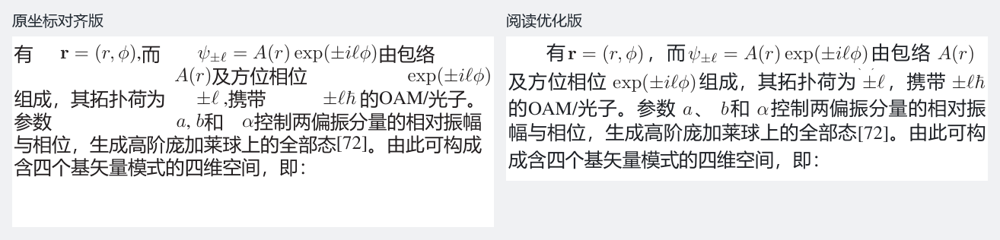
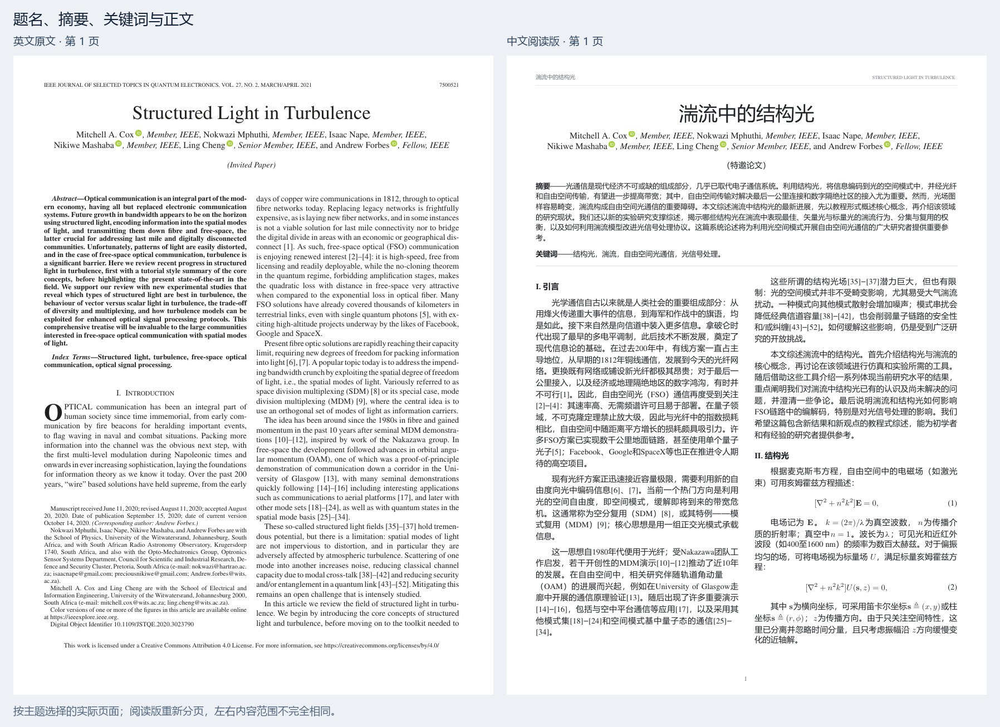
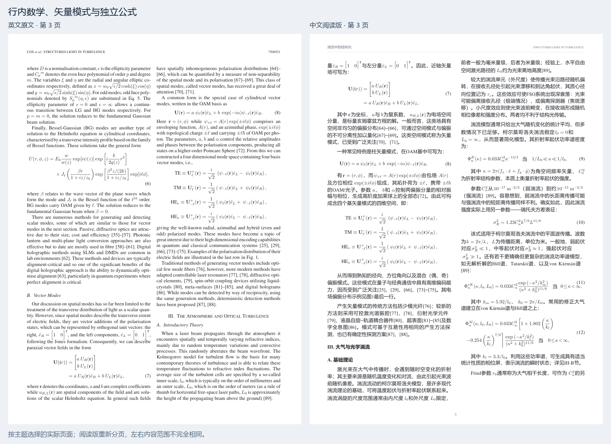
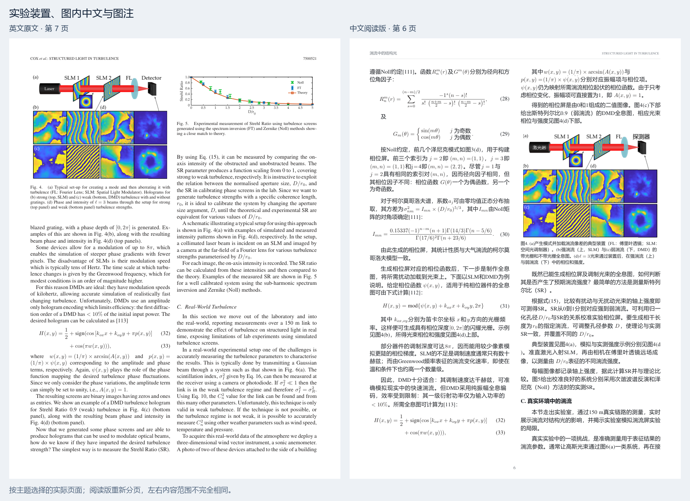

# Paper Translate Faithful

**在 Codex 中，把英文论文 PDF 翻译成中文，并尽量保留公式、图表和原文结构。**

适合完整论文翻译、原文对照阅读，以及修复“翻译了但不好读”的中文排版。

## 能做到什么

| 内容 | 处理能力 |
|---|---|
| 全文 | 翻译题名、摘要、关键词、正文、图表题注、脚注及附录，统一专业术语 |
| 公式 | 优先保留原生字形、上下标和括号；检查跨行公式、基线及编号 |
| 图片与表格 | 翻译可辨认的图内文字，保护科学图形；核对表格行列、单位和数字 |
| 排版 | **原位版**保留页数与锚点；**阅读版**在授权范围内重排，改善大空白和混乱公式 |
| 验收 | 源译单元、资产和文件哈希可追溯，逐页检查；未审校或存在漏项时不能发布 |

**能力边界：**由 Codex 配合本地脚本完成翻译与审查。模糊扫描、复杂底纹图字、跨页大表等可能需要专门处理；不承诺任意 PDF 一键无误。默认继承原文字号、字重，公式不因中文换字体而重写。

## 实际效果

Cox 2021 案例：**21 页英文 → 21 页原位中文 / 19 页阅读版**，处理 36 个编号公式、14 幅图和 1 张表。**21 项回归测试通过**；通用工具另用 23 个单元、157 个数学字形的真实节选验证。数据仅代表该案例和测试范围。[详细验证](references/validation.md)



<details>
<summary>查看 3 组真实论文页面前后对比</summary>

阅读版重新分页；左右按相同主题选页，内容范围不完全相同。





示例：Cox 等，*Structured Light in Turbulence*（2021），CC BY 4.0；中文翻译和重排为改编。[署名与页码](docs/comparisons/attribution.md)

</details>

## 在 Codex 上部署

需要本机已安装 **Git、Python**，并有可用的中文字体。Windows 在 PowerShell 执行：

```powershell
$skillPath = Join-Path $HOME '.agents/skills/paper-translate-faithful'
New-Item -ItemType Directory -Force (Split-Path $skillPath) | Out-Null
git clone https://github.com/YuchenBaooo/paper-translate-faithful.git $skillPath
python -m pip install -r "$skillPath/requirements-reader.txt"
python "$skillPath/scripts/paperflow.py" doctor
```

<details>
<summary>macOS / Linux</summary>

```bash
skill_dir="$HOME/.agents/skills/paper-translate-faithful"
mkdir -p "$HOME/.agents/skills"
git clone https://github.com/YuchenBaooo/paper-translate-faithful.git "$skill_dir"
python3 -m pip install -r "$skill_dir/requirements-reader.txt"
python3 "$skill_dir/scripts/paperflow.py" doctor
```

</details>

`doctor` 检查 PDF 依赖、字体和可选工具；缺字体时按提示配置本机路径。OCR 按需另配。已有同名目录时不要覆盖，更新仓库即可。

Codex 自动发现用户目录 `~/.agents/skills` 中的技能；未出现时重启。随后提供 PDF 路径，在 Codex 对话中输入：

```text
使用 $paper-translate-faithful 翻译这篇论文：<PDF 路径>。
输出中文阅读优化版，允许重新分页，保留原字号字重与科学内容，核对公式、图中文字和表格。
```

如需严格原位，将要求改为“保留原页数、分栏和图表位置”。[Codex 官方技能说明](https://learn.chatgpt.com/docs/build-skills)

## 包含内容与消耗

- **工具**：原位回填、阅读重排、矢量公式组合、图字修复、文献整理、局部 OCR、核验和压缩。
- **示例**：9 类 few-shot、原生片段、图字遮罩和可运行合同。[示例说明](references/few-shots.md)
- **流程**：清点原文 → 翻译与复核 → 处理公式图表 → 排版 → 逐页审校 → 发布。[完整步骤](references/reading-layout.md)
- **Token**：暂无可核验的每篇平均值。消耗取决于全文长度、图像输入和审校轮次；本地 PDF 脚本本身不调用语言模型。

[技能入口](SKILL.md) · [字体配置](references/typography.md) · [便携技能包](dist/paper-translate-faithful.skill)
